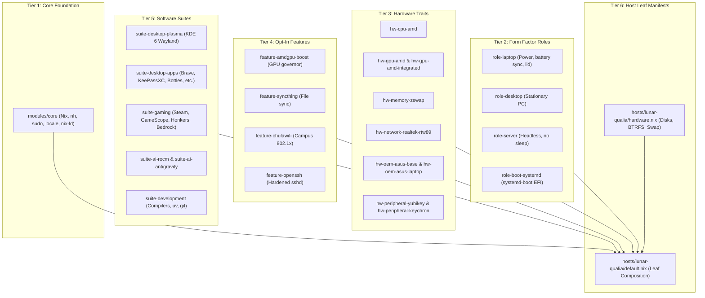

# AI Agent Guidelines & Architecture Manual: `lunar-witches`

> **Note for AI Agents & Autonomous Coders:**  
> This file is the primary orientation and architectural reference for this repository. Read this file before inspecting or modifying any configuration. All contributions must adhere strictly to the invariants, conventions, and dendritic composition patterns outlined below.

---

## 1. System Identity & Core Invariants

- **Repository:** [`/home/nnon/lunar-witches`](file:///home/nnon/lunar-witches)
- **Framework:** NixOS 26.11 (Zokor) managed via a **dendritic Nix Flake** using `flake-parts` and `home-manager`.
- **Primary Deployment Target:** `lunar-qualia` (ASUS TUF Gaming A14 FA401EA, AMD Strix Halo APU, 32GB LPDDR5X UMA).
- **Branch:** `master`

### Mandatory Behavioral Rules

1. **Host-Specific Profiles:**
   - ALWAYS verify the target hostname (e.g. `hostname`).
   - Read the corresponding hardware and swap profile at `~/.gemini/devices/<hostname>.md` before making host-specific hardware or memory recommendations.
2. **TTM Allocation & VRAM Limits:**
   - ALWAYS check the active TTM memory limit using `mem-ttm` before recommending local model loading or heavy graphics/compute allocations.
3. **Declarative NixOS Only:**
   - NEVER suggest or execute imperative package managers (`apt`, `dnf`, `rpm`, `pacman`) or imperative bootloader tools (`grubby`, `update-grub`).
   - All system packages, kernel parameters, daemons, and environment variables MUST be declared in Nix files within this repository.
4. **Privilege Escalation & AskPass (`nh` & `sudo`):**
   - When suggesting commands requiring `sudo`, ALWAYS use `sudo -A` (Askpass). The system is configured with KDE Plasma's `ksshaskpass` graphical dialog so user credentials are never handled directly by the agent.
   - For `nh os switch`, `nh`'s internal Rust elevation logic specifically requires `NH_SUDO_ASKPASS` (or `NH_SUDOOPTS="-A"`) to pass `-A` to `sudo`. `NH_SUDO_ASKPASS=/run/current-system/sw/bin/ksshaskpass` is declaratively provisioned in `suite-desktop-plasma` and `user-nnon.home.sessionVariables`. When executing `nh os switch` in non-login subshells or fresh scripts, explicitly prefix `NH_SUDO_ASKPASS=/run/current-system/sw/bin/ksshaskpass nh os switch ...` to guarantee graphical authentication.
5. **Containerization Interface:**
   - NEVER suggest raw `podman` CLI commands. The host runs rootless Podman aliased to the `docker` CLI interface for consistent tooling and caching. Suggest `docker` commands instead.
6. **Nix Store Secrets Boundary:**
   - NEVER commit API tokens, passwords, or private keys to `.nix` files or Git history.
   - The `/nix/store` is world-readable (`chmod -R a+r`). Secrets belong strictly in `~/.config/secrets.env` (`chmod 600`), sourced declaratively in shell init scripts (`fish.shellInit` / `bash.initExtra`).

---

## 2. The 6-Tier Dendritic Architecture

The configuration is structured as a **dendritic tree** where leaf hosts compose decoupled, reusable traits rather than inheriting monolithic configurations:



---

## 3. Directory Taxonomy & Responsibilities

| Directory | Module / Export | Scope & Classification Criteria |
| :--- | :--- | :--- |
| **`modules/core/`** | `self.nixosModules.core` | Universal baseline for ALL machines (servers, laptops, desktops). Nix settings, `nh` helper, basic CLI utilities, locale, zsh/bash/fish basics, `nix-ld`. Zero GUI or hardware assumptions. |
| **`modules/roles/`** | `self.nixosModules.role-*` | Machine form-factor roles: `laptop.nix` (battery management, power-profiles-daemon), `desktop.nix` (stationary, sleep policies), `server.nix` (headless), `boot-systemd.nix`. |
| **`modules/hardware/`** | `self.nixosModules.hw-*` | Silicon, bus, and peripheral drivers: CPU microcode (`cpu/amd`), GPU drivers (`gpu/amd`, `gpu/amd-integrated`), zswap (`memory/zswap`), Wi-Fi chipsets (`network/realtek-rtw89`), OEM platforms (`oem/asus/*`), and peripherals (`peripherals/yubikey`, `peripherals/keychron`). |
| **`modules/features/`** | `self.nixosModules.feature-*` | Opt-in services and background daemons that may not be required by every machine (e.g. `amdgpu-boost.nix`, `syncthing.nix`, `chulawifi.nix`, `openssh.nix`). |
| **`modules/suites/`** | `self.nixosModules.suite-*` | Curated collections of software packages and desktop capabilities: `desktop/plasma.nix`, `desktop/apps.nix`, `gaming/default.nix`, `ai/rocm.nix`, `ai/antigravity.nix`, `development/default.nix`. |
| **`modules/users/`** | `self.nixosModules.user-*` | User account definitions and integrated Home Manager configuration (`users/nnon/default.nix`, `shell.nix`, `development.nix`, `desktop.nix`, `plasma.nix`). |
| **`hosts/<hostname>/`** | `flake.nixosConfigurations.<host>` | Host-specific composition manifests (`default.nix`) and physical partition/UUID configurations (`hardware.nix`). Supplies machine-specific numbers (RAM limits, card names). |
| **`pkgs/`** | `flake.overlays.default` | Custom in-tree Nix derivations (`mem-ttm`, `amdgpu-boost`, `sync-power-state`, `service-deck-helper`). Built and exported to system overlays. |
| **`retrospects/`** | Markdown docs | Architectural decision records (ADRs), post-mortems, and migration logs. |

---

## 4. Key Placement & Domain Rules

When adding new configurations or options, follow these boundary guidelines:

1. **Where does a Windows utility belong? (`bottles` vs. `steam`):**
   - General-purpose Windows emulation (`bottles`) belongs in **`modules/suites/desktop/apps.nix`** because it runs academic software, VPN utilities, and productivity tools.
   - Gaming-specific runners (`steam`, `gamescope`, `honkers-launcher`, `bedrock-on-linux`) belong strictly in **`modules/suites/gaming/default.nix`**.
2. **Where do hardware parameters belong?:**
   - NEVER hardcode arbitrary machine limits (such as `5862940` TTM pages or `card1` DRM devices) inside `modules/hardware/`.
   - Expose typed options via `lib.mkOption` (e.g. `hardware.amdgpu.integrated.ttmPagesLimit`, `services.amdgpu-boost.card`) and assign the exact values in the leaf manifest `hosts/<hostname>/default.nix`.
3. **Upstream Mesa & Kernel Features:**
   - Do NOT introduce redundant driver environment variables if newer Mesa/Kernel versions stabilize them upstream.
   - Example: Mesa 26.2.3 enables `bfloat16` by default on RDNA 3/3.5, making `RADV_EXPERIMENTAL = "bfloat16"` obsolete.
4. **Computer Use Agent (CUA) Driver Boundary:**
   - Input injection tools (`CUA_DRIVER_RS_ENABLE_WAYLAND`) belong in the desktop Wayland suite (`modules/suites/desktop/plasma.nix`), not the AI compute suite, because they require an active display session.
5. **Native Module Wrapping:**
   - Avoid creating custom wrapper options (e.g. `services.lunar-syncthing`) around native NixOS services. Configure upstream services directly using `lib.mkDefault` so downstream hosts can override properties effortlessly.
6. **Enterprise Network Profiles & Secrets Boundary:**
   - Network profiles requiring proprietary or campus 802.1x enterprise authentication (`ChulaWiFi`) belong in `modules/features/chulawifi.nix`.
   - Invariants: Never embed passwords into Nix store files. Use NetworkManager's `ensureProfiles.environmentFiles` to substitute `$CHULA_WIFI_PASSWORD` into `/run/NetworkManager/system-connections/` at runtime (in RAM with 0600 permissions).
   - RADIUS Quirks: Enterprise networks relying on legacy RADIUS TLS 1.0 handshakes require `phase1-auth-flags = 32` (0x20) and `openssl-ciphers = "DEFAULT@SECLEVEL=0"`.

---

## 5. Adding a New Machine to the Flake

To introduce a new host (e.g. `lunar-station`):

1. **Create Partition Manifest (`hosts/lunar-station/hardware.nix`):**
   ```nix
   { config, lib, pkgs, modulesPath, ... }:
   {
     imports = [ (modulesPath + "/installer/scan/not-detected.nix") ];
     # Declare fileSystems, swapDevices, boot.initrd.availableKernelModules
   }
   ```
2. **Create Leaf Composition (`hosts/lunar-station/default.nix`):**
   ```nix
   { self, inputs, ... }:
   {
     flake.nixosConfigurations.lunar-station = inputs.nixpkgs.lib.nixosSystem {
       system = "x86_64-linux";
       specialArgs = { inherit inputs self; };
       modules = [
         ./hardware.nix
         self.nixosModules.core
         self.nixosModules.role-desktop
         # Compose hardware traits
         self.nixosModules.hw-cpu-amd
         self.nixosModules.hw-gpu-amd
         # Compose software suites
         self.nixosModules.suite-desktop-plasma
         self.nixosModules.suite-development
         # Attach user
         inputs.home-manager.nixosModules.home-manager
         self.nixosModules.user-nnon
         ({ pkgs, ... }: {
           networking.hostName = "lunar-station";
           nixpkgs.config.allowUnfree = true;
           nixpkgs.overlays = [ self.overlays.default ];
         })
       ];
     };
   }
   ```
3. **Register Host in `flake.nix`:**
   Add `./hosts/lunar-station` to the `imports` list in [`flake.nix`](file:///home/nnon/lunar-witches/flake.nix).
4. **Create Device Profile:**
   Create `~/.gemini/devices/lunar-station.md` documenting its CPU, GPU, memory, and swap layout.

---

## 6. Daily Operations & Verification Commands

All routine operations should be conducted through declarative tooling:

```bash
# 1. Format and check syntax
nix fmt ./**.nix

# 2. Dry-build evaluation test (no root required)
nix build .#nixosConfigurations.lunar-qualia.config.system.build.toplevel --dry-run

# 3. Build and cache candidate generation locally
nh os build /home/nnon/lunar-witches

# 4. Activate configuration on live system (triggers graphical ksshaskpass via NH_SUDO_ASKPASS)
nh os switch /home/nnon/lunar-witches
# (If executing from a non-login subshell or automated runner, explicitly prefix:
# NH_SUDO_ASKPASS=/run/current-system/sw/bin/ksshaskpass nh os switch /home/nnon/lunar-witches)

# 5. Clean older generations (keeps last 3)
nh clean all --keep 3
```
