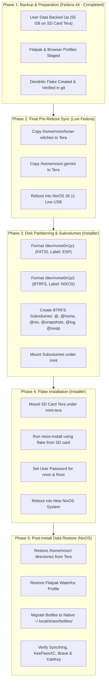

# Retrospect 01: Fedora 44 to NixOS Migration & Restoration Manual

> **Status:** Completed Historical Manual  
> **Date:** 2026-09-30  
> **Target Machine:** ASUS TUF Gaming A14 FA401EA (`lunar-qualia`)  
> **Hardware Platform:** AMD Ryzen AI Max+ 392 (Strix Halo APU, Radeon 8060S / `gfx1151`, NPU `aie2p`)  
> **Source OS:** Fedora 44 (Workstation, Linux 6.14/6.15, GNOME/KDE, BTRFS root)  
> **Destination OS:** NixOS 26.11 (Zokor, Dendritic Flake + Home Manager + BTRFS + KDE Plasma 6 Wayland)  
> **Repository Working Directory:** [`/home/nnon/lunar-witches`](../..)  
> **Migration Storage Backup:** SD Card `Tera` at `/run/media/nnon/Tera/nixos-migration/`

---

## 1. Migration Architecture & Workflow Overview



---

## 2. Inventory & Backup Audit

All critical personal files, configurations, credentials, and application states were verified on SD Card partition `/run/media/nnon/Tera/nixos-migration/`:

| Component | Fedora Source Path | Backup Target on SD Card | Status | Notes |
| :--- | :--- | :--- | :---: | :--- |
| **Brave Profile** | `~/.config/BraveSoftware` | `.../home/nnon/.config/BraveSoftware` | ✅ Backed up | Includes extensions, tabs, history |
| **KWallet Keys** | `~/.local/share/kwalletd` | `.../home/nnon/.local/share/kwalletd` | ✅ Backed up | **Mandatory** for Brave cookie/password decryption |
| **Waterfox Profile** | `~/.var/app/net.waterfox.waterfox` | `.../flatpak_migration/net.waterfox.waterfox` | ✅ Backed up | Restores to Flatpak Waterfox |
| **Syncthing Identity** | `~/.local/state/syncthing` | `.../home/nnon/.local/state/syncthing` | ✅ Backed up | `cert.pem` & `key.pem` maintain existing cluster ID |
| **KeePassXC Vault** | `~/Sync` & `~/.config/keepassxc` | `.../home/nnon/Sync`, `.../.config/keepassxc` | ✅ Backed up | Contains master password databases |
| **YubiKey 5C NFC** | Host CCID & Udev | Declared in Flake | ✅ Configured | `pcscd` + `libu2f-host` + `yubikey-manager` |
| **Bottles & ProtonPlus** | `~/.var/app/com.usebottles.bottles`, `~/.config/ProtonPlus` | `.../flatpak_migration/`, `.../.config/ProtonPlus` | ✅ Backed up | Native `pkgs.bottles` & `pkgs.protonplus` in Flake |
| **Digital Logic Sim** | `~/.digital.cfg` | `.../home/nnon/.digital.cfg` | ✅ Backed up | Native `pkgs.digital` declared in Home Manager |
| **VS Code Config** | `~/.config/Code`, `~/.local/share/vscode` | `.../home/nnon/.config/Code` | ✅ Backed up | `programs.vscode` + `nix-ld` for unpatched extensions |
| **CU Academic Data** | `~/CU` | `.../home/nnon/CU` | ✅ Backed up | Preserved across migration |
| **SSH Keys** | `~/.ssh` | `.../home/nnon/.ssh` | ✅ Backed up | Permissions preserved (`-aHAX`) |
| **Fastfetch & Configs** | `~/.config/fastfetch` | `.../home/nnon/.config/` | ✅ Backed up | Deployed into Home Manager |
| **GPU Boost Utility** | `~/.local/bin/amdgpu-boost` | `.../home/nnon/.local/bin/amdgpu-boost` | ✅ Backed up | Re-implemented as systemd user service in Flake |
| **BullVPN Client** | `~/.local/bin/bullvpn` | `.../home/nnon/.local/bin/bullvpn` | ✅ Backed up | Dependencies (`nftables`, `wireguard-tools`) in Flake |
| **Keychron Rules** | `/etc/udev/rules.d/99-keychron.rules` | `.../system/99-keychron.rules` | ✅ Backed up | Implemented in `hw-peripheral-keychron` |
| **Antigravity Suite** | Antigravity CLI & State | Flake input `antigravity-nix` | ✅ Configured | `google-antigravity-cli` in Flake |
| **Nix Flake Tree** | `/home/nnon/lunar-witches` | Staged & Committed in Git | ✅ Backed up | Copied as final step before rebooting |
| **Antigravity State** | `/home/nnon/.gemini` | Preserved on SD Card | ✅ Backed up | Restored to `~/.gemini` on first boot |

---

## 3. Storage Layout & Installation Runbook

### Step 3.1: Final Pre-Reboot Backup (Run on Fedora)

```bash
# 1. Sync the flake repository
rsync -aHAX --info=progress2 /home/nnon/lunar-witches/ /run/media/nnon/Tera/nixos-migration/lunar-witches/

# 2. Sync the complete Antigravity CLI and state directory
rsync -aHAX --info=progress2 /home/nnon/.gemini/ /run/media/nnon/Tera/nixos-migration/home/nnon/.gemini/

# 3. Flush disk buffers
sync
```

### Step 3.2: Boot Live Installer & Prepare Storage Layout

Boot using the graphical NixOS Live USB. Open Konsole and partition the target NVMe SSD:

#### 1. Partition the NVMe SSD (`/dev/nvme0n1`)
```bash
sudo -i

# Clear existing partition table
sgdisk -Z /dev/nvme0n1

# Partition 1: 1024 MiB EFI System Partition (type EF00)
sgdisk -n 1:0:+1024M -t 1:ef00 -c 1:"ESP" /dev/nvme0n1

# Partition 2: Remaining space for BTRFS (type 8300)
sgdisk -n 2:0:0 -t 2:8300 -c 2:"NIXOS" /dev/nvme0n1

# Inform kernel of partition changes
partprobe /dev/nvme0n1
```

#### 2. Format Partitions
```bash
# Format Partition 1 as FAT32 with label ESP
mkfs.fat -F 32 -n ESP /dev/nvme0n1p1

# Format Partition 2 as BTRFS with label NIXOS
mkfs.btrfs -f -L NIXOS /dev/nvme0n1p2
```

#### 3. Create BTRFS Subvolumes
```bash
# Mount root BTRFS volume temporarily
mount -t btrfs /dev/disk/by-label/NIXOS /mnt

# Create subvolumes matching hardware.nix
btrfs subvolume create /mnt/@
btrfs subvolume create /mnt/@home
btrfs subvolume create /mnt/@nix
btrfs subvolume create /mnt/@snapshots
btrfs subvolume create /mnt/@log
btrfs subvolume create /mnt/@swap

# Unmount temporary mount
umount /mnt
```

#### 4. Mount Subvolumes to Target Directory (`/mnt`)
```bash
# Mount root subvolume
mount -o subvol=@,noatime,compress=zstd:1 /dev/disk/by-label/NIXOS /mnt

# Create mount points
mkdir -p /mnt/{boot,home,nix,.snapshots,var/log,swap}

# Mount secondary subvolumes
mount -o subvol=@home,noatime,compress=zstd:1 /dev/disk/by-label/NIXOS /mnt/home
mount -o subvol=@nix,noatime,compress=zstd:1 /dev/disk/by-label/NIXOS /mnt/nix
mount -o subvol=@snapshots,noatime,compress=zstd:1 /dev/disk/by-label/NIXOS /mnt/.snapshots
mount -o subvol=@log,noatime,compress=zstd:1 /dev/disk/by-label/NIXOS /mnt/var/log
mount -o subvol=@swap,nodatacow /dev/disk/by-label/NIXOS /mnt/swap

# Mount EFI System Partition
mount /dev/disk/by-label/ESP /mnt/boot

# Initialize nodatacow swap directory and pre-allocate swapfile
chattr +C /mnt/swap
btrfs filesystem mkswapfile --size 48g /mnt/swap/swapfile
```

---

### Step 3.3: Network Setup, SD Card Mount & `nixos-install`

```bash
# 1. Mount SD Card outside of /mnt
mkdir -p /mnt-tera
mount /dev/disk/by-label/Tera /mnt-tera

# 2. Tell Git to trust repositories across UIDs
git config --global --add safe.directory '*'

# 3. Trust the Lantian CachyOS binary cache in Live installer
mkdir -p /root/.config/nix
cat << 'EOF' >> /root/.config/nix/nix.conf
extra-substituters = https://attic.xuyh0120.win/lantian https://nix-community.cachix.org
extra-trusted-public-keys = lantian:EeAUQ+W+6r7EtwnmYjeVwx5kOGEBpjlBfPlzGlTNvHc= nix-community.cachix.org-1:mB9FSh9qf2dCimDSUo8Zy7bkq5CX+/rkCWyvRCYg3Fs=
EOF

# 4. Execute installation using the pre-configured dendritic flake
nixos-install \
  --flake /mnt-tera/nixos-migration/lunar-witches#lunar-qualia \
  --no-root-password \
  --option extra-substituters https://attic.xuyh0120.win/lantian \
  --option extra-trusted-public-keys lantian:EeAUQ+W+6r7EtwnmYjeVwx5kOGEBpjlBfPlzGlTNvHc=

# 5. Set user password for nnon
nixos-enter --root /mnt -c "passwd nnon"

# 6. Unmount SD card before rebooting
umount /mnt-tera
```

---

### Step 3.4: First Boot & User Data Restoration

Reboot into the fresh NixOS 26.11 installation under KDE Plasma 6:

```bash
umount -R /mnt
reboot
```

Log in as `nnon` and execute data restoration:

```bash
# 1. Restore Home Directory Data (Documents, Downloads, CU, Sync, Pictures, .ssh, .gemini, etc.)
rsync -aHAX --info=progress2 /run/media/nnon/Tera/nixos-migration/home/nnon/ /home/nnon/

# 2. Restore Flake Repository into working directory
rsync -aHAX --info=progress2 /run/media/nnon/Tera/nixos-migration/lunar-witches/ /home/nnon/lunar-witches/

# 3. Restore Waterfox Flatpak
flatpak remote-add --if-not-exists flathub https://dl.flathub.org/repo/flathub.flatpakrepo
flatpak install -y flathub net.waterfox.waterfox
mkdir -p ~/.var/app
rsync -aHAX --info=progress2 /run/media/nnon/Tera/nixos-migration/flatpak_migration/net.waterfox.waterfox/ ~/.var/app/net.waterfox.waterfox/

# 4. Migrate Bottles Data to Native NixOS Bottles
mkdir -p ~/.local/share/bottles/
rsync -aHAX --info=progress2 /run/media/nnon/Tera/nixos-migration/flatpak_migration/com.usebottles.bottles/data/bottles/ ~/.local/share/bottles/
find ~/.local/share/bottles/bottles/ -name "*.yml" -exec sed -i 's|/home/nnon/.var/app/com.usebottles.bottles/data/bottles|/home/nnon/.local/share/bottles|g' {} +

# 5. Fix Academic Course Symlink (I2CEDT)
ln -sfn "/home/nnon/.local/share/bottles/bottles/I2CEDT/drive_c/users/nnon/Documents/I2CEDT" "/home/nnon/CU/Y1/I2CEDT"

# 6. Ensure Correct SSH Permissions
chmod 700 /home/nnon/.ssh
chmod 600 /home/nnon/.ssh/id_* 2>/dev/null || true
chmod 644 /home/nnon/.ssh/*.pub 2>/dev/null || true
```

---

## 4. Post-Migration Verification Checklist

1. **Brave Browser:** Verified extensions, logins, bookmarks, history (KWallet auto-unlocks secrets).
2. **Waterfox (Flatpak):** Verified cookies, profile, pinned tabs.
3. **Syncthing:** Verified cluster ID and peer connectivity at `http://127.0.0.1:8384`.
4. **KeePassXC & YubiKey:** Verified HMAC-SHA1 challenge-response unlocks vault in `~/Sync/`.
5. **Digital Simulator:** Verified `.dig` simulation workflows.
6. **Visual Studio Code:** Verified language servers via `nix-ld`.
7. **Bottles & BullVPN:** Verified Windows VPN profiles and token discovery.
8. **AMD GPU Boost:** Verified `amdgpu-boost` user service.
9. **Antigravity CLI:** Verified continuous pairing and session state preservation.
